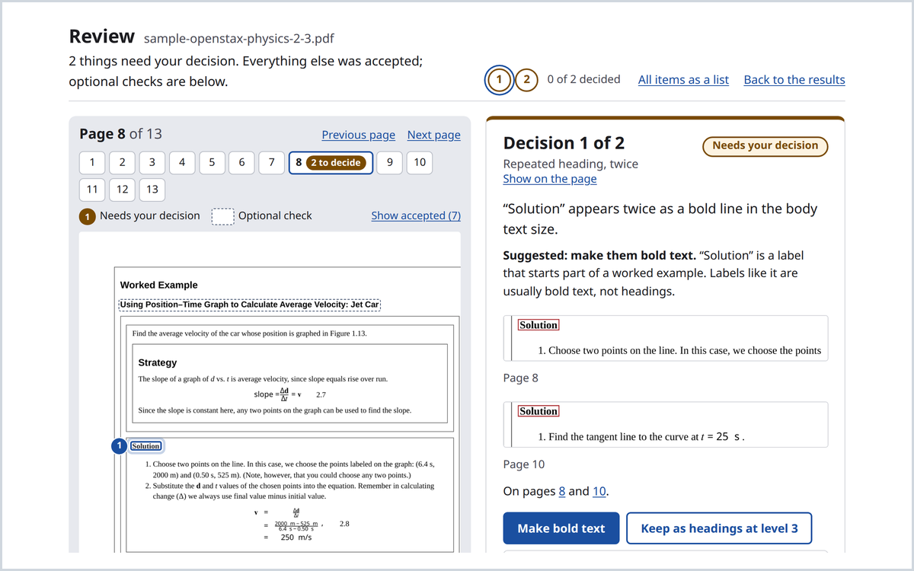
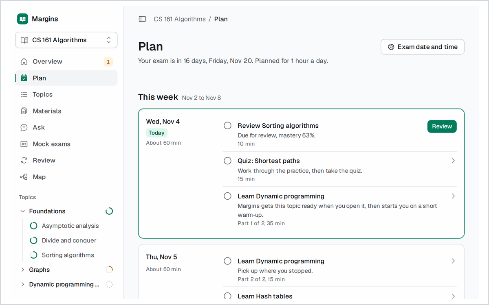
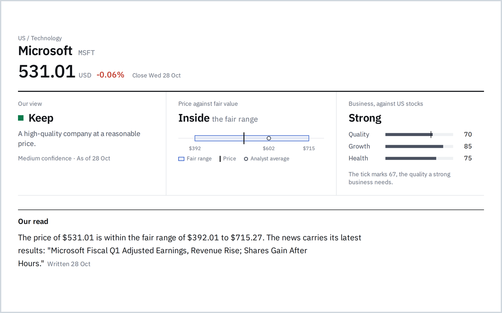

## Hi, I'm Harish

I'm a software engineer at [Purgo AI](https://www.purgo.ai/) in the San Francisco Bay Area. I work across our data-engineering agent, a multi-agent LangGraph system that turns a data team's ticket into PySpark, SQL and dbt code: retrieval, context engineering, prompts, orchestration and evals.

[harishmanoharan.com](https://harishmanoharan.com?ref=github-readme) · [Resume](https://harishmanoharan.com/HarishManoharan.pdf?ref=github-readme) · [LinkedIn](https://www.linkedin.com/in/harishm17/) · [Email](mailto:harish_manoharan@outlook.com)

### At Purgo AI, since 2025

**[Designing retrieval and code review for a data-engineering agent](https://harishmanoharan.com/work/agent-retrieval/?ref=github-readme)**

I designed the agent's retrieval: the pipeline that picks the few tables the LLM sees out of hundreds. Its hard case is a table the ticket needs but never mentions, so my fix follows the dbt lineage of the models the ticket does name. On a benchmark of 103 real tickets it cut missed tables from 79 to 24, with no extra LLM call. I also built several of the checks in the loop that reviews the agent's code.

**[Testing LLMs and Databricks platforms for regulated use](https://harishmanoharan.com/work/llm-evaluation/?ref=github-readme)**

I built, end to end, the two products life-sciences companies use to validate an AI model or a Databricks platform before regulated (GxP) work. Each run ends in a report the customer signs for its auditors.

### Projects

Three products I built on my own time. Each is live and open source, with a write-up.

<table>
  <tr>
    <td width="44%" valign="top"></td>
    <td valign="top"><b><a href="https://readablestem.com">ReadableSTEM</a></b> 
    Turns STEM course PDFs into web pages a screen reader can read. In a test registered before it ran, on 1,715 equations it had never seen, it matched a Claude Opus chatbot on accuracy with about half the silent errors (wrong equations with no warning) at a third of the cost. 
    <a href="https://harishmanoharan.com/work/readablestem/?ref=github-readme">Write-up</a> · <a href="https://harishmanoharan.com/work/readablestem-evaluation/?ref=github-readme">Evaluation</a> · <a href="https://github.com/harishm17/readablestem">Source</a></td>
  </tr>
</table>

<table>
  <tr>
    <td width="44%" valign="top"></td>
    <td valign="top"><b><a href="https://studymargins.com">Margins</a></b> 
    A study app that makes you try before it helps, built on your own course files. The tutor's hint level is enforced in server code, and scripted students test whether it gives the answer away: in the latest run, 0 of 172 replies did. 
    <a href="https://harishmanoharan.com/work/margins/?ref=github-readme">Write-up</a> · <a href="https://studymargins.com/evaluation">Evaluation</a> · <a href="https://github.com/harishm17/margins">Source</a></td>
  </tr>
</table>

<table>
  <tr>
    <td width="44%" valign="top"></td>
    <td valign="top"><b><a href="https://holdbrief.com">Holdbrief</a></b> 
    A daily brief on the US and Indian stocks you follow. Code sets every number and call, an LLM writes the explanation, and a checker removes any sentence it can't trace to the facts. 
    <a href="https://harishmanoharan.com/work/holdbrief/?ref=github-readme">Write-up</a> · <a href="https://holdbrief.com/today">Live demo</a> · <a href="https://github.com/harishm17/holdbrief">Source</a></td>
  </tr>
</table>

### Background

M.S. in computer science, UT Dallas (2026). Dual degree in biological sciences and data science, IIT Madras (2024), with a master's thesis at The Jackson Laboratory.

Outside work: hackathons (third of about 40 teams at the Kane CLI Hackathon by TestMu AI, October 2026), hiking, table tennis, and chess on [Lichess](https://lichess.org/@/harishm17) and [Chess.com](https://www.chess.com/member/pika_pika17).
