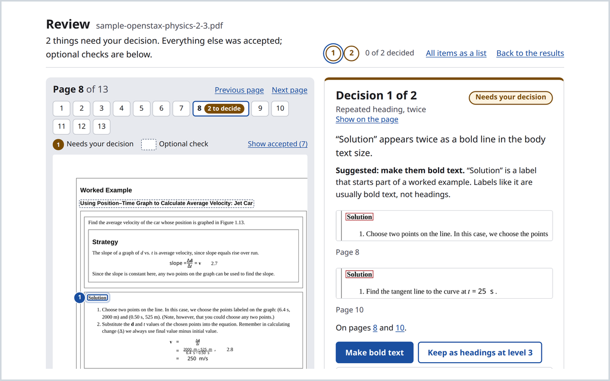
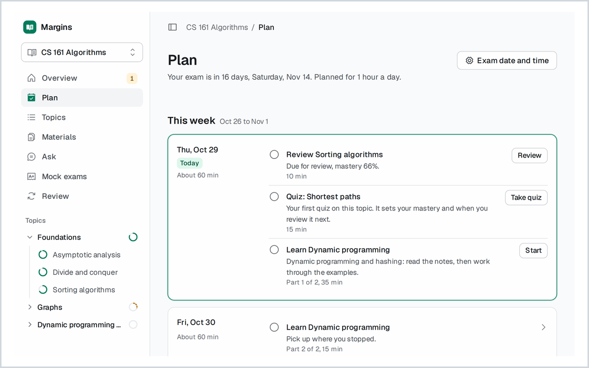
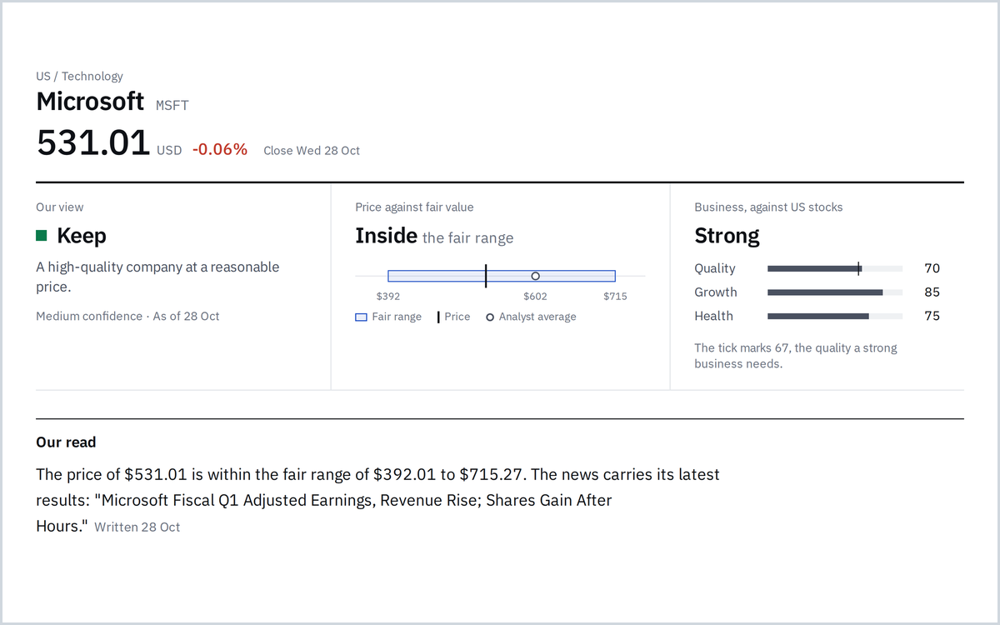

## Hi, I'm Harish

I'm a software engineer at [Purgo AI](https://www.purgo.ai/) in the San Francisco Bay Area. I design and build LLM agents, retrieval and evals.

[harishmanoharan.com](https://harishmanoharan.com) · [Write-ups](https://harishmanoharan.com/work/) · [LinkedIn](https://www.linkedin.com/in/harishm17/) · [Email](mailto:harish_manoharan@outlook.com)

### At Purgo AI, since 2025

- **[Table retrieval for a data-engineering agent](https://harishmanoharan.com/work/agent-retrieval/).** Our LangGraph agent turns data-engineering tickets into PySpark, SQL and dbt code. I designed how it finds the tables a ticket needs: candidates from the ticket, a Pinecone catalog search and dbt lineage, then a warehouse schema check and an LLM ranker, within a fixed context budget. Following dbt lineage cut missed tables from 79 to 24 across 103 tickets.
- **[Code review and cost](https://harishmanoharan.com/work/agent-retrieval/#self-review).** I built much of the review that checks the agent's code before it ships, and moved two of its stages to a smaller model, cutting their cost 7.6x.
- **[Validation for regulated AI](https://harishmanoharan.com/work/llm-evaluation/).** I built our two validation products, which qualify a customer's LLM deployment or Databricks platform for regulated (GxP) use. Life-sciences customers use them for signed audit reports.

### Things I've built

<table>
  <tr>
    <td width="44%" valign="top"></td>
    <td valign="top"><b><a href="https://readablestem.com">ReadableSTEM</a></b> 
    Turns STEM course PDFs into accessible web pages, with equations a screen reader can speak. On held-out tests fixed before any system ran, it reaches heading F1 0.96, and 97% of its figure descriptions pass a model judge. I also published where a chatbot still beats it on equations. 
    <a href="https://harishmanoharan.com/work/readablestem/">Write-up</a> · <a href="https://harishmanoharan.com/work/readablestem-evaluation/">Evaluation</a> · <a href="https://github.com/harishm17/readablestem">Source</a></td>
  </tr>
</table>

<table>
  <tr>
    <td width="44%" valign="top"></td>
    <td valign="top"><b><a href="https://studymargins.com">Margins</a></b> 
    Turns your own course files into cited notes, worked examples, quizzes and timed practice exams, plus a voice coach. Give it your exam date and it plans each day's work and tracks what you've mastered. 
    <a href="https://github.com/harishm17/margins">Source</a></td>
  </tr>
</table>

<table>
  <tr>
    <td width="44%" valign="top"></td>
    <td valign="top"><b><a href="https://holdbrief.com">Holdbrief</a></b> 
    A daily brief on the stocks you follow, for US and Indian markets. Fixed scoring methods set each stock's stance, and every sentence Claude writes has to cite the facts behind it; a checker rejects any that don't. 
    <a href="https://holdbrief.com/sample">Sample brief</a> · Source private</td>
  </tr>
</table>

### Background

**Stack:** Python, TypeScript, SQL, LangGraph, PySpark, dbt, Databricks, Pinecone, Postgres with pgvector, FastAPI, Next.js, Azure, AWS.

**Internships:** at Digitus (2024) I built a text-to-SQL agent that raised execution accuracy from 52% to 76%, and a RAG helpdesk assistant that cut median time to resolution from 20 minutes to 6. At PwC (2023) I built a customer analytics platform.

**Education:** M.S. in computer science, UT Dallas (2026). Dual degree in biological sciences and data science, IIT Madras (2024), with a master's thesis at The Jackson Laboratory on finding behaviors in mouse videos without labels.

Outside work I build at hackathons, where my team recently placed third of about 40 at the Kane CLI hackathon. I also hike, play table tennis and play chess on [Lichess](https://lichess.org/@/harishm17) and [Chess.com](https://www.chess.com/member/pika_pika17).
